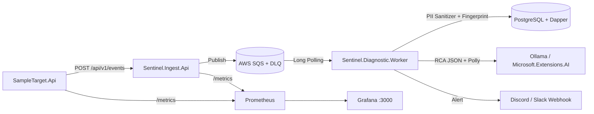

# SentinelAI

Copiloto de **AIOps & Diagnóstico Automatizado de Incidentes** construído em **.NET** com arquitetura orientada a eventos (**AWS SQS + S3 + PostgreSQL/Dapper**), **Microsoft.Extensions.AI**, **Polly**, **OpenTelemetry**, **Grafana** e testes **Unitários + BDD (Reqnroll) + Integração (Testcontainers)**.

## Arquitetura



## Módulos

- **`Sentinel.Ingest.Api`**: Minimal API que recebe eventos/alertas (`POST /api/v1/events`), expõe `/metrics` (Prometheus) e enfileira no **SQS**.
- **`Sentinel.Diagnostic.Worker`**: Consome o SQS, mascara PII (`PiiSanitizer`), calcula fingerprint (`IncidentFingerprinter`), deduplica no **PostgreSQL** via **Dapper**, gera RCA via **Microsoft.Extensions.AI (Ollama)** protegido por **Polly (Timeout + Retry + Circuit Breaker + Fallback)** e dispara **Webhook**.
- **`Sentinel.SampleTarget.Api`**: API alvo de demonstração instrumentada com **OpenTelemetry**, com endpoints para simular falhas reais (`/simulate/slow-query`, `/simulate/null-ref`, `/simulate/external-timeout`).
- **`Sentinel.Shared`**: Contratos, sanitizador de PII e algoritmo de fingerprinting.
- **`infra/`**: `docker-compose.yml` (PostgreSQL 16, LocalStack SQS/S3, Prometheus, Grafana e Ollama opcional) + template **AWS CloudFormation** (`infra/aws/cloudformation.yaml`).

## Como rodar localmente

1. Subir infraestrutura e observabilidade (PostgreSQL, LocalStack, Prometheus, Grafana):
   ```bash
   cd infra && docker compose up -d
   # Opcional: subir Ollama junto
   # docker compose --profile ai up -d
   ```

2. Rodar os testes:
   ```bash
   # Testes unitários e BDD (rápidos, sem Docker)
   dotnet test --filter "Category!=Integration"

   # Testes de integração com Testcontainers (requer Docker)
   dotnet test --filter "Category=Integration"
   ```

3. Iniciar os serviços (em terminais separados):
   ```bash
   dotnet run --project src/Sentinel.Diagnostic.Worker
   dotnet run --project src/Sentinel.Ingest.Api --urls http://localhost:5000
   dotnet run --project src/Sentinel.SampleTarget.Api --urls http://localhost:5100
   ```

4. Simular falhas reais e acompanhar no **Grafana** (`http://localhost:3000`, login `admin`/`admin`):
   ```bash
   curl -X POST http://localhost:5100/simulate/slow-query
   curl -X POST http://localhost:5100/simulate/null-ref
   curl -X POST http://localhost:5100/simulate/external-timeout
   ```

## Roadmap

- [x] **Fase 1:** Solution .NET, Ingest API, SQS (LocalStack), Worker, Deduplicação no Postgres (Dapper), Sanitizador de PII e testes unitários.
- [x] **Fase 2:** Integração `Microsoft.Extensions.AI` (Ollama) + Polly (Timeout, Retry, Circuit Breaker, Fallback) + Webhook Notifier + testes com `NSubstitute`.
- [x] **Fase 3:** `SampleTarget.Api` com falhas simuladas + OpenTelemetry + Prometheus + Grafana.
- [x] **Fase 4:** BDD (`Reqnroll`), Integração (`Testcontainers.PostgreSql`), AWS CloudFormation, GitHub Actions CI e SonarCloud config.
